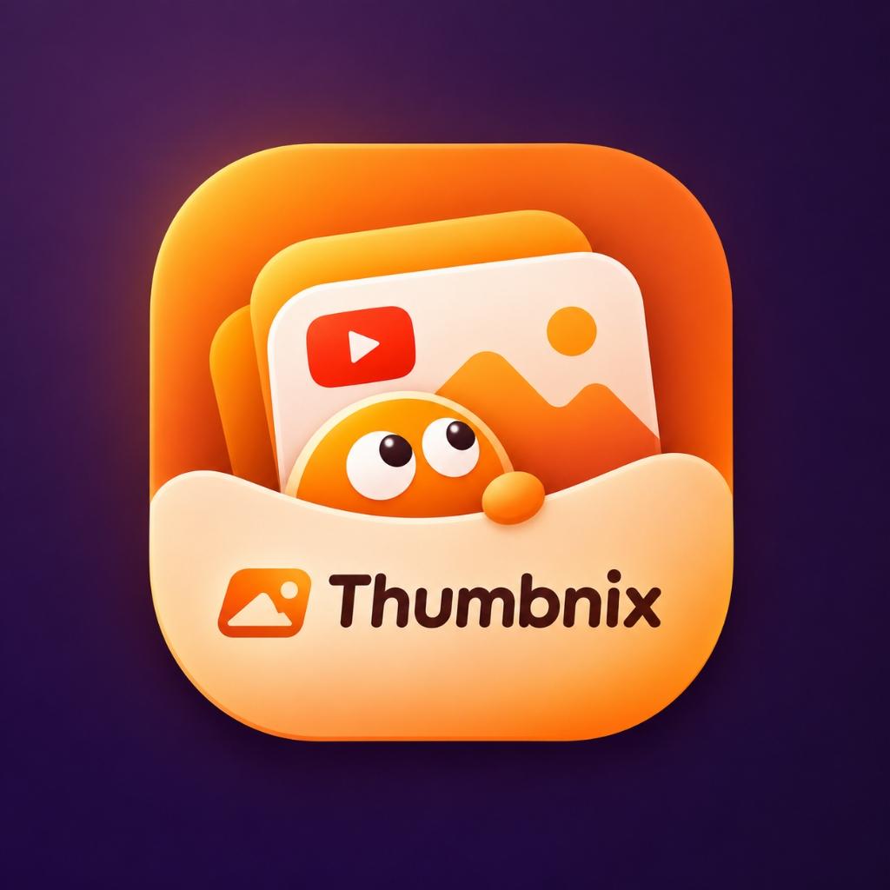
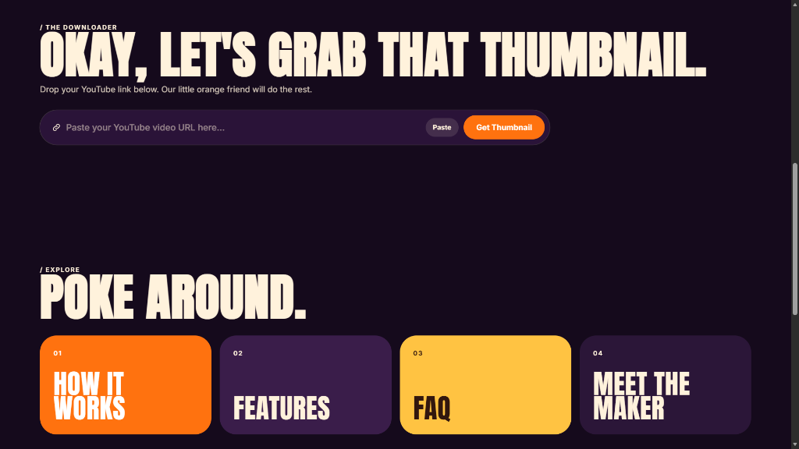

<p align="center">
  
</p>

<h1 align="center">Thumbnix 🍊</h1>

<p align="center">
  <strong>Thumbnails. Without the drama.</strong><br>
  A lightweight, secure, and playful YouTube thumbnail downloader & previewer powered by a friendly orange mascot.
</p>

<p align="center">
  <a href="https://thumbnix-yt.vercel.app/" target="_blank">
    
  </a>
  <a href="https://vercel.com" target="_blank">
    
  </a>
  <a href="LICENSE">
    
  </a>
  <a href="https://github.com/ayumadeit/Thumbnix/stargazers">
    
  </a>
</p>

---

## 💡 About Thumbnix

**Thumbnix** is a high-performance, full-stack utility designed to fetch, preview, and cleanly download YouTube video thumbnails in all available resolutions. It pairs a playful vanilla HTML/CSS/JS frontend with a lightweight, secure TypeScript serverless backend running on Vercel.

- **No CORS issues:** Downloads save directly to your device with proper filenames via serverless streaming.
- **Genuine availability check:** Detects YouTube's 120×90 dummy placeholder images by parsing raw JPEG SOF marker headers.
- **Video metadata:** Fetches live video title and channel name via YouTube oEmbed without requiring any API keys.
- **Download all as ZIP:** Bundles every available resolution into a single `.zip` file on the fly.
- **Zero tracking & abuse protection:** Rate-limited by IP (hashed in memory), strict SSRF allowlists, and no user data stored.

👉 **Try it live at [https://thumbnix-yt.vercel.app](https://thumbnix-yt.vercel.app/)**

---

## ✨ Features

- 🎯 **Maximum HD Quality**: Extracts the highest available resolution (`maxresdefault` up to 1080p).
- 📐 **True Server-Side Verification**: Inspects JPEG binary markers to verify real dimensions and file sizes, filtering out fake placeholders.
  - **Maximum (HD)**: `1920×1080` / `1280×720`
  - **Standard**: `640×480`
  - **High**: `480×360`
  - **Medium**: `320×180`
  - **Default**: `120×90`
- 🎬 **YouTube Shorts & Live Streams**: Supports `youtube.com/watch`, `youtu.be/`, `/shorts/`, `/embed/`, `/live/`, and bare 11-char IDs.
- 📦 **Download All (ZIP)**: One-click bundle to download all available resolutions in `thumbnix-[id].zip`.
- 🏷️ **Video & Creator Context**: Displays the real video title and creator channel name on the results card.
- 🛡️ **Graceful Fallback**: If the API is offline or unreachable, the frontend seamlessly falls back to client-side probing so the UI never breaks.
- 🌓 **Dark & Light Mode**: Theme toggle with persistent local storage.
- 🍊 **Interactive Mascot**: Responsive SVG buddy that tracks your mouse and reacts to your interactions.

---

## 📸 Screenshots

<p align="center">
  
</p>

<p align="center">
  
</p>

<p align="center">
  
</p>

---

## 📡 API Reference

All responses return standard JSON with playful error messages unless streaming a binary file.

### 1. `GET /api/thumbnails?url=<url_or_id>`
Probes all resolutions, extracts metadata, and checks availability.

**Example Request:**
```http
GET /api/thumbnails?url=https://www.youtube.com/watch?v=dQw4w9WgXcQ
```

**Example Response:**
```json
{
  "videoId": "dQw4w9WgXcQ",
  "metadata": {
    "title": "Rick Astley - Never Gonna Give You Up (Official Music Video)",
    "channel": "Rick Astley"
  },
  "best": "maxresdefault",
  "thumbnails": [
    {
      "quality": "maxresdefault",
      "label": "Maximum (HD)",
      "width": 1280,
      "height": 720,
      "bytes": 104233,
      "url": "https://i.ytimg.com/vi/dQw4w9WgXcQ/maxresdefault.jpg",
      "downloadUrl": "/api/download?id=dQw4w9WgXcQ&quality=maxresdefault"
    }
  ]
}
```

### 2. `GET /api/download?id=<id>&quality=<quality>`
Streams the thumbnail directly with `Content-Disposition: attachment; filename="thumbnix-[id]-[quality].jpg"` for native 1-click downloads.
- Validates `id` with `^[A-Za-z0-9_-]{11}$` and `quality` against fixed whitelist.
- Only ever connects to `i.ytimg.com` (SSRF protected).

### 3. `GET /api/download-all?id=<id>`
Fetches all available resolutions and streams a generated ZIP archive (`thumbnix-[id].zip`).
- Filenames inside ZIP: `{id}-{quality}-{width}x{height}.jpg`.

### 4. `GET /api/health`
Returns `{ "ok": true, "version": "1.0.0" }`.

---

## 🔒 Security & Abuse Protection

- **Rate Limiting:** 30 req/min for `/api/thumbnails` and 20 req/min for download endpoints per IP. Hashed with SHA-256 in memory; IPs are never logged. Optional Upstash Redis integration for distributed deployments.
- **SSRF Protection:** Strict allowlists only permit requests to `i.ytimg.com` and `www.youtube.com/oembed`. Query parameters are strictly validated with Zod.
- **Security Headers:** `X-Content-Type-Options: nosniff`, `Referrer-Policy: strict-origin-when-cross-origin`, and restricted CORS.

---

## 🛠️ Tech Stack

- **Frontend**: Vanilla HTML5, Modern CSS3 (Variables & Keyframes), Vanilla ES6+ JavaScript.
- **Backend**: Vercel Serverless Functions (Node.js 20, TypeScript).
- **Validation & Utilities**: `zod`, `fflate` (high-speed pure JS ZIP generator).
- **Testing**: `vitest` (unit tests for URL parser, JPEG SOF reader, endpoints, security, and rate limiting).
- **Hosting**: [Vercel](https://vercel.com) Edge Network.

---

## 💻 Local Development

```bash
# 1. Clone repository
git clone https://github.com/ayumadeit/Thumbnix.git
cd Thumbnix

# 2. Install dependencies
npm install

# 3. Run test suite
npm test

# 4. Start local development server with Vercel CLI
npx vercel dev
```

Visit `http://localhost:3000` in your browser.

---

## ⚙️ Environment Variables

Copy `.env.example` to `.env`:

```ini
# Production origin allowed for CORS (defaults to https://thumbnix-yt.vercel.app and localhost)
ALLOWED_ORIGIN=https://thumbnix-yt.vercel.app

# Optional: Upstash Redis for distributed rate limiting across serverless instances
UPSTASH_REDIS_REST_URL=
UPSTASH_REDIS_REST_TOKEN=
```

---

## ⚖️ Copyright & Fair Use Notice

Thumbnix is an independent utility that only retrieves and previews thumbnail images that YouTube already publishes publicly for videos. Downloading a thumbnail does not grant ownership, copyright, or commercial reuse rights. All rights, title, and intellectual property remain with the respective content creators and copyright holders.

---

## 👨‍💻 Maker

Built with curiosity, pixels, and passion by **Ayush Anand**:

- 🌐 **GitHub**: [@ayumadeit](https://github.com/ayumadeit)
- 💼 **LinkedIn**: [ayush-linked](https://www.linkedin.com/in/ayush-linked)

---

## 📄 License

This project is open-source and available under the [MIT License](LICENSE).

<p align="center">
  Made with 🧡 & a tiny orange buddy · <strong>Thumbnix</strong>
</p>
