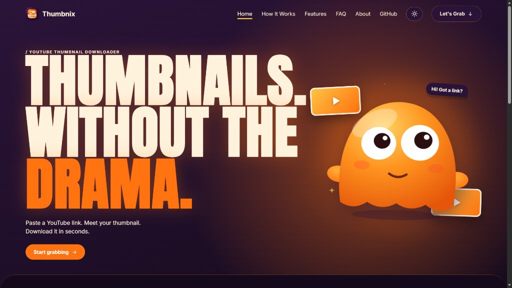
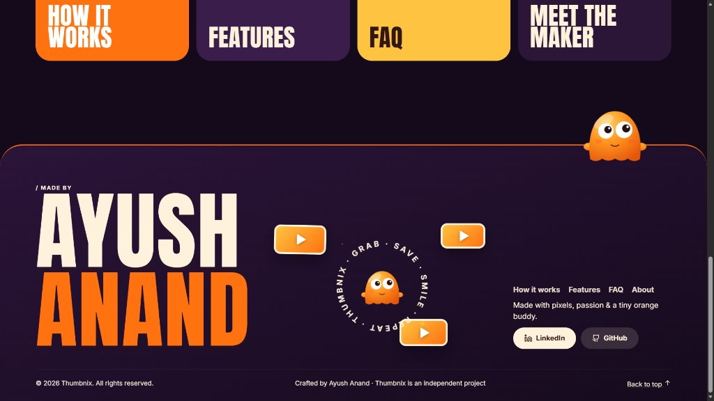
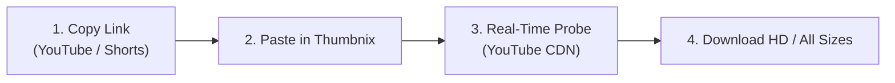

<p align="center">
  
</p>

<h1 align="center">Thumbnix 🍊</h1>

<p align="center">
  <strong>Thumbnails. Without the drama.</strong><br>
  A lightweight, interactive YouTube thumbnail grabber and previewer powered by a friendly orange mascot.
</p>

<p align="center">
  <a href="https://thumbnix-yt.vercel.app/" target="_blank">
    
  </a>
  <a href="https://vercel.com" target="_blank">
    
  </a>
  <a href="LICENSE">
    
  </a>
  <a href="https://github.com/ayumadeit/Thumbnix/stargazers">
    
  </a>
</p>

---

## 💡 About Thumbnix

**Thumbnix** is a fast, dependency-free web tool built to fetch, preview, and download YouTube video thumbnails in any available resolution. No bloated frameworks, no registrations, no tracking forms, and zero drama — just paste your link and grab your thumbnail in seconds.

👉 **Try it live at [https://thumbnix-yt.vercel.app](https://thumbnix-yt.vercel.app/)**

---

## ✨ Features

- 🎯 **Maximum HD Quality**: Automatically extracts the highest available resolution (`maxresdefault` up to 1080p).
- 📐 **All Resolutions Checked**: Probes YouTube's CDN in real-time to find which sizes actually exist for your video:
  - **Maximum (HD)**: `1920×1080` / `1280×720`
  - **Standard**: `640×480`
  - **High**: `480×360`
  - **Medium**: `320×180`
  - **Default**: `120×90`
- 🎬 **YouTube Shorts & Live Streams**: Supports `youtube.com/watch`, `youtu.be/`, `/shorts/`, `/embed/`, and `/live/` links.
- 👁️ **Instant Previews**: Inspect and compare all sizes before downloading.
- 📋 **One-Click Actions**: Single-click to direct download, copy image URLs, or download all sizes sequentially.
- 🌓 **Dark & Light Mode**: Seamless theme switching with persistent local storage preferences.
- 🍊 **Interactive Mascot**: A responsive, animated little buddy that reacts to your mouse, link submissions, and clicks!
- 🔒 **Zero Sign-Ups & Privacy-First**: Everything is executed directly in your browser without saving user data.

---

## 📸 Screenshots

<p align="center">
  
</p>

<p align="center">
  
</p>

<p align="center">
  
</p>

---

## 🚀 How It Works



1. **Copy**: Copy any YouTube video, Shorts, or live stream link.
2. **Paste**: Drop it into Thumbnix's search bar.
3. **Grab**: Select your desired resolution and hit **Download** or **Copy URL**.

---

## 🛠️ Tech Stack & Architecture

- **Frontend**: Pure Semantic HTML5, Modern CSS3 with CSS Variables & Keyframe Animations, Vanilla ES6+ JavaScript.
- **Hosting & CDN**: Deployed on [Vercel](https://vercel.com) Edge Network with `vercel.json` clean URL routing.
- **Assets**: Custom 3D brand logo and favicon.

---

## 💻 Local Development

You can run Thumbnix locally without any build steps or package managers:

```bash
# 1. Clone the repository
git clone https://github.com/ayumadeit/Thumbnix.git

# 2. Navigate to the project directory
cd Thumbnix

# 3. Open directly in your browser or run any static server:
# Using Python:
python -m http.server 3000

# Using Node:
npx serve .
```

Visit `http://localhost:3000` in your browser.

---

## 🗺️ Roadmap & Future Backend

Thumbnix is designed to expand into a full-stack utility. Planned backend capabilities include:

- [ ] **Serverless Proxy Endpoint**: Bypass browser CORS restrictions for 100% direct instant downloads on all browsers.
- [ ] **One-Click ZIP Bundle**: Download all thumbnail resolutions zipped into a single archive file.
- [ ] **Format Conversion**: Convert thumbnails to `.png` or `.webp` directly before downloading.
- [ ] **Video Metadata**: Fetch channel name, title, duration, and view counts via YouTube oEmbed API.

---

## 👨‍💻 Maker

Built with curiosity, pixels, and passion by **Ayush Anand**:

- 🌐 **GitHub**: [@ayumadeit](https://github.com/ayumadeit)
- 💼 **LinkedIn**: [ayush-linked](https://www.linkedin.com/in/ayush-linked)

---

## 📄 License

This project is open-source and available under the [MIT License](LICENSE).

<p align="center">
  Made with 🧡 & a tiny orange buddy · <strong>Thumbnix</strong>
</p>
